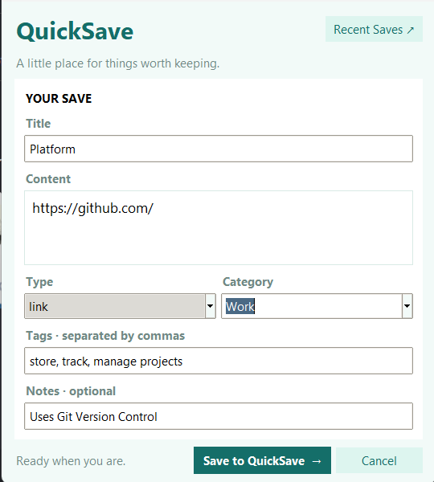
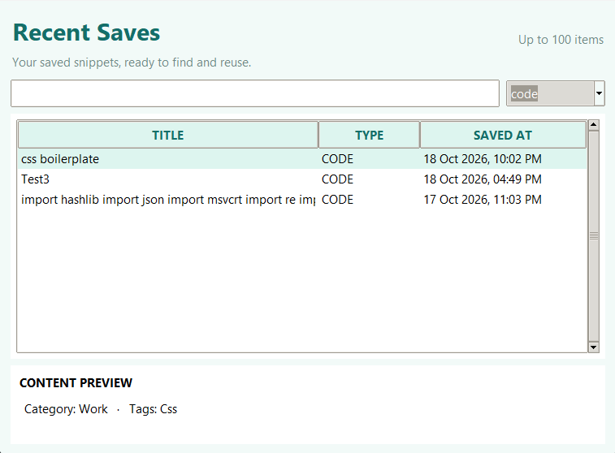
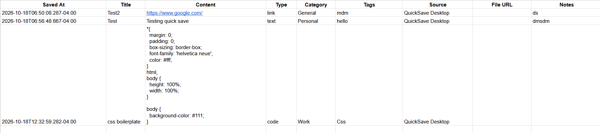
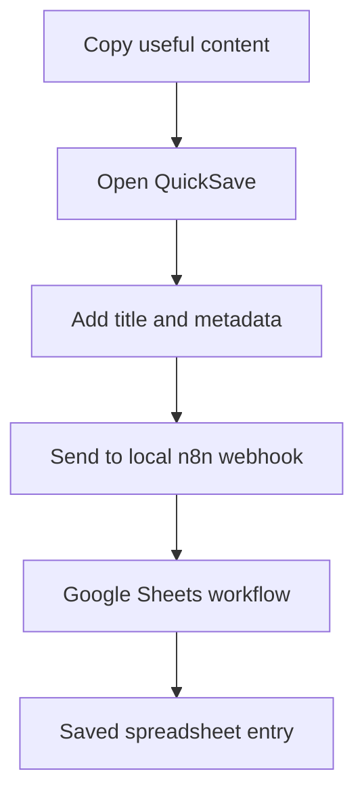

# QuickSave Desktop

<p align="center">
  <strong>A simple, lightweight clipboard saver for Windows.</strong>
  <br />
  Capture useful text, save snippets, and send your saved content to Google Sheets through a local n8n workflow.
</p>

<p align="center">
  
  
  
  
</p>

---

## Overview

QuickSave Desktop is a personal productivity tool that makes it easier to capture and organize useful information from your clipboard.

Instead of switching between applications to save snippets manually, open QuickSave, enter the details, and send your content to a Google Sheets workflow powered by n8n.

## Features

- **Quick capture:** Open the save window using `Ctrl + Shift + S`.
- **Clipboard saving:** Save text and URLs with relevant metadata.
- **Organized snippets:** Add titles, categories, tags, and notes.
- **Recent Saves:** Review previous items and copy their content.
- **Duplicate detection:** Help identify content that has already been saved.
- **System tray:** Access QuickSave from the Windows notification area.
- **Google Sheets integration:** Send saved items to a spreadsheet through n8n.
- **Local history:** Retain a local history of saved items.
- **Windows startup:** Configure QuickSave to launch when you sign in.

## Screenshots

<p align="center">
  
</p>
<p align="center">
  
</p>
<p align="center">
  
</p>

## How it works



QuickSave runs on Windows. The application sends data to a locally running n8n webhook, which handles the Google Sheets integration.

## Requirements

- Windows 10 or Windows 11
- Python 3.12 or a compatible version
- Docker Desktop with n8n running locally
- A Google account and a Google Sheets document
- An n8n workflow configured to receive QuickSave data and write it to your spreadsheet

## Getting started

### 1. Clone the repository

```powershell
git clone https://github.com/ElrheaDeSouza/QuickSave.git
cd quicksave-desktop
```

### 2. Create a virtual environment

```powershell
py -m venv .venv
.\.venv\Scripts\Activate.ps1
```

### 3. Install dependencies

```powershell
python -m pip install -r requirements.txt
```

### 4. Start n8n

Start your local n8n instance and activate your QuickSave workflow.

By default, QuickSave expects the webhook at:

```text
http://localhost:5678/webhook/quicksave
```

Make sure your workflow uses the expected webhook path and maps the incoming fields to the correct Google Sheets columns.

**Note:** The n8n workflow and Google credentials are not included in this repository. You must configure your own local workflow and Google Sheets connection.

### 5. Run QuickSave

```powershell
python quicksave.py
```

Use `Ctrl + Shift + S` to open the save window.

## Building the Windows executable

To create a standalone application folder:

```powershell
python -m PyInstaller --noconfirm --clean --windowed --onedir --name QuickSave quicksave.py
```

The executable will be generated at:

```text
dist/QuickSave/QuickSave.exe
```

Test the executable before distributing it. QuickSave still requires a compatible local n8n workflow for Google Sheets integration.


## Project structure

```text
quicksave-desktop/
├── quicksave.py
├── requirements.txt
├── README.md
├── LICENSE
└── .gitignore
```

## Contributing

This project is primarily developed for personal use. Suggestions, bug reports, and improvements are welcome.

## License

This project is licensed under the MIT License. See the [LICENSE](LICENSE) file for details.
